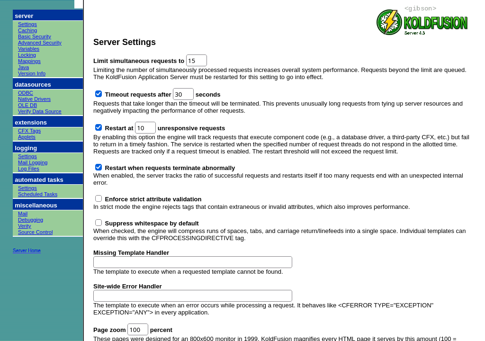

# KoldFusion Application Server 4.5

*A nostalgic tribute to the CFML application servers of 1999, written from scratch in C.*

```
  KoldFusion Application Server Enterprise 4.5.1 SP2
  Copyright (c) 1995-1999 Gibson Mainframe Co. All rights reserved.
  (A nostalgic tribute. Not affiliated with anyone, living or acquired.)
```

**Home page: https://happycatkitten.github.io/koldfusion/**



KoldFusion is a working web server plus CFML engine that behaves as much as possible like Allaire ColdFusion 4.5: same
tags and functions, the same `YES`/`NO` output, the same famous *Error Diagnostic Information* pages, the same
registry-driven Administrator with the navy-and-sage frameset, the same weak password "encryption", and the same
`C:\CFUSION`-style install layout. It is not affiliated with Allaire, Macromedia or Adobe; names are changed slightly on
purpose (KoldFusion by Gibson).

## Quick start

```bash
make
./bin/kfserver
```

Then open:

| URL | What |
|---|---|
| http://127.0.0.1:8500/ | The post-install Welcome page |
| http://127.0.0.1:8500/CFIDE/administrator/ | The KoldFusion Administrator (password: `admin`) |
| http://127.0.0.1:8500/CFDOCS/testinstallation/test.cfm | "Congratulations!" installation test |
| http://127.0.0.1:8500/CFDOCS/dochome.cfm | Documentation and CFML Language Reference |
| http://127.0.0.1:8500/CFDOCS/examplehome.cfm | Example applications |
| http://127.0.0.1:8500/demos/ | Demo gallery of openly-licensed CFML found around the web |
| http://127.0.0.1:8500/cool/ | Cool Stuff You Can Do |
| http://localhost:8500/web1999/ | The 1999 Web: twelve retro sites, each on its own virtual host |
| https://localhost:8543/ | The same server over SSL (self-signed certificate, made on first start) |
| http://127.0.0.1:8500/cool/phonebook.cfm | Employee Phone Directory: CFLDAP against the built-in directory server |
| ldap://127.0.0.1:3890/ | The Gibson Directory Server, a bundled LDAPv3 directory (`o=Gibson Mainframe Co, c=US`) |

Options: `-p PORT` (default 8500), `--ssl-port PORT` (default 8543, `0` = no SSL), `-b ADDRESS` (default 127.0.0.1 —
keep it that way, the security is authentically 1999), `-r INSTALLDIR` (default `kfroot/`), `-w WEBROOT` (default
`wwwroot/`), `--reset-admin-password NEWPW`, `--run page.cfm [query-string]` (render a single page to stdout, handy for
testing), `--ldap-port PORT` (run the directory server on another port this time), `--no-ldap` (do not start it).

Requirements: a C compiler, GNU make, pthreads. No other libraries. SSL (the https:// listener and https:// in CFHTTP)
uses OpenSSL 3 or 1.1 if it is installed, loaded at run time, so the build never needs its headers; on first start
`/usr/bin/openssl` makes a self-signed certificate in `kfroot/ssl/` (`curl --cacert kfroot/ssl/kfserver.crt
https://localhost:8543/` trusts it). Python 3 + Pillow only if you want to regenerate the GIFs (`make graphics`,
`python3 tools/mkadmin_gfx.py`). A Java runtime is optional (see [Java](#java)).

## What's inside

```
src/            the server (about 15,000 lines of C)
  core.c          arenas, values, structs, arrays, queries, dates
  parse.c         CFML template parser (tags, <!--- comments --->, #expressions#)
  expr.c          expression parser/evaluator (IS, EQ, CONTAINS, MOD, &, IMP...), scopes, assignment
  script.c        CFSCRIPT (4.5 level: no user-defined functions)
  interp.c        execution, template cache, Application.cfm, error pages, debug output
  tags*.c         ~80 CFML tags        func*.c   ~230 built-in functions
  sql.c           the "KoldFusion Flat-File Driver": a small SQL engine over text tables
  http.c          HTTP/1.1 web server (keep-alive)     session.c  session/application/client scopes, CFLOCK
  netio.c, tls.c  sockets with deadlines; SSL via OpenSSL loaded at run time      httpc.c  CFHTTP client
  registry.c      REGEDIT4-format registry           crypto.c   CFMX_COMPAT Encrypt(), MD5 Hash(), uuencode
  mail.c          CFMAIL spool + SMTP delivery        sched.c    CFSCHEDULE scheduler
  verity.c        Verity-style collections, CFINDEX/CFSEARCH     wddx.c  WDDX 1.0
  cfx.c, kfx.h    CFX tags as shared libraries        security.c Advanced Security, CFAUTHENTICATE
  ftp.c           CFFTP client                        strict.c   strict attribute validation
  ldap.c          CFLDAP, an LDAPv3 client; LDAP user directories for Advanced Security
  ldapd.c         the Gibson Directory Server, a bundled LDAPv3 server (LDIF-backed)
  ber.c           BER codec, RFC 2254 filters, DNs, SHA-1 (shared by ldap.c and ldapd.c)
  java.c          the embedded JVM (JNI, loaded with dlopen), Java objects, CreateObject/JavaCast/GetException
  java_ext.c      Java CFX tags, CFSERVLET/CFSERVLETPARAM      kfjni.h  a hand-written JNI subset (no jni.h needed)
java/           src/: the Java CFX API (com.gibson.cfx + com.allaire.cfx), a Servlet 2.2 API, the C<->Java bridge;
                samples/: CFX_JAVAHELLO, CFX_JAVAQUERY, HelloServlet, SnoopServlet, Employee (built into kfroot/java/)
kfroot/         the install directory ("C:\CFUSION"): registry/, log/, mail/{spool,undelivr}, db/, verity/, cfx/, customtags/, ldap/, java/
wwwroot/        the web root: Welcome page, /CFIDE/administrator, /CFDOCS, /demos, /cool, /web1999, sites/ (virtual sites)
cfx/            source of the sample CFX tags (CFX_HELLO, CFX_DICE, CFX_SYSINFO)
tools/          graphics generators (all GIFs are drawn procedurally — no original artwork is used)
docs/           RESEARCH.md (what the real thing looked like), ENGINE_NOTES.md (how to write pages)
```

## The 1999 Web

Twelve parody web sites from the dot-com boom, hosted the way IIS hosted virtual sites: each one lives in
`wwwroot/sites/<name>/` and answers at `http://<name>.localhost:8500/` (also at `http://localhost:8500/sites/<name>/`).
Start at the ring hub, http://localhost:8500/web1999/.

**They're also live on GitHub Pages: https://happycatkitten.github.io/web1999/** (repository
[HappyCatKitten/web1999](https://github.com/HappyCatKitten/web1999), kept in step with `python3 tools/sync_web1999.py ../web1999`).

| Site | A takeoff of | Highlights |
|---|---|---|
| Yowza! | Yahoo! | 124 directory categories, 352 invented sites, search, Suggest a Site, My Yowza! |
| AltaVisor | AltaVista | A crawler (`tools/crawl.py`) that spiders every other site plus an invented "rest of the Web"; ranked search, Translate |
| Ask Reeves | Ask Jeeves | Plain-English questions, "I have found answers to the following questions:", Peek Through the Keyhole |
| Orinoco.com | Amazon.com | 148 invented books, reviews, cart, 3-step checkout, 1-Click |
| uBid | eBay | 197 auctions that really end and relist, proxy bidding, feedback stars, My uBid |
| eToyz | eToys | Shop by age, Gift Finder, wish lists, "Order by Dec. 20" countdown |
| Petz.com | Pets.com | Argyle the Sock Dog, a stock ticker that only goes up, a hidden liquidation page |
| GeoHoods | GeoCities | 251 member homepages in 15 neighborhoods, guestbooks, webrings, Build-a-Page, File Manager |
| Hamster Shuffle | Hampster Dance | 356 dancing critters and an original chiptune |
| Dashdot | Slashdot | 41 stories, ~1,000 threaded comments, moderation, thresholds, polls |
| Snapster | Napster | Song search, fake downloads with progress bars, chat channels |
| CNM Interactive | CNN.com | 81 stories from December 20, 1999, QuickVote, Y2K countdown |

The sites are plain static HTML: carts, bids, comments and votes are done the 1999 way, with cookies and
`document.write()`. All links are relative, so the folders work anywhere. Each site keeps its Python generators (pages,
Pillow graphics, MIDI) and its link checker in its own `tools/` folder. Every name, story, product and graphic is
invented.

## The Administrator

Every page from the 4.5 navigation is implemented and saves to the registry:

- **server**: Settings (request limit, timeouts, *Restart at N unresponsive requests* watchdog, whitespace suppression,
  missing-template and site-wide error handlers), Web Server & SSL (keep-alive, timeouts, the secure listener and its
  certificate - a KoldFusion extra, since 4.5 left that to IIS), Caching (template cache, trusted cache, query cache), Basic Security
  (admin/Studio passwords, tag restrictions, unsecured tags directory), Advanced Security (user directories, security
  contexts, rules, policies, sandboxes, resource view, map), Variables (client storage in registry/cookie/data source,
  session & application timeouts), Locking (none / full checking / automatic read locking / single-threaded sessions),
  Mappings, Java (JVM settings, a live status line and a Load JVM button), Version Info (with live server statistics).
- **datasources**: ODBC, Native Drivers, OLE DB, Verify Data Source (plus a table browser).
- **extensions**: CFX Tags (real `.so` CFX tags written in C, and Java CFX tags), Applets.
- **logging**: Settings, Mail Logging, Log Files (viewer, download, delete).
- **automated tasks**: Scheduler Settings, Scheduled Tasks (one-time, daily/weekly/monthly, every N minutes, RUN now,
  publish to file).
- **miscellaneous**: Mail (verify, spool and undeliverable folder), Debugging (debug output appended to pages, IP
  restrictions), Verity (create/index/repair/optimize/purge/delete collections), Source Control, Directory Server
  (the bundled LDAP directory: settings, start/stop, restore the sample directory, browse the tree).

## LDAP: CFLDAP and the Gibson Directory Server

`CFLDAP` is a complete LDAPv3 client written from scratch in C (BER over TCP, no SDK): ACTION="Query" with every
SCOPE, RFC 2254 filters, ATTRIBUTES (a list or `*`, plus a DN column), client-side SORT/SORTCONTROL,
STARTROW/MAXROWS, REFERRAL/REBIND, and Add, Modify (MODIFYTYPE add/delete/replace), ModifyDN and Delete with
SEPARATOR/DELIMITER. Errors read like the originals: `An error has occured while trying to execute query :[LDAP:
error code 32 - No Such Object]`. It honours the Basic Security tag restrictions.

So that it has something to talk to, KoldFusion starts the **Gibson Directory Server 1.0** next to the web server
(127.0.0.1:3890, a Netscape Directory Server look-alike). It answers any LDAP client (`ldapsearch -x -H
ldap://127.0.0.1:3890 -b "o=Gibson Mainframe Co,c=US" "(sn=S*)"`), supports bind, search, add, modify, delete,
modify DN, compare and "Who am I?", stores userPassword as `{SHA}` like Netscape did, has a `cn=Directory Manager`
(password `admin`) and a `cn=Directory Administrators` group, and keeps everything in `kfroot/ldap/gibson.ldif`.
It is seeded with the 25 employees of the cfsnippets data source (each one's password is their uid) and
department groups. Pages find it through `Server.Directory.Host`, `.Port` and `.BaseDN`.

Advanced Security user directories of type LDAP work against it, or any other LDAP server: `CFAUTHENTICATE`
binds as the user (SiteMinder-style DN lookup or a search), and LDAP group membership feeds `IsAuthorized()`. A
fresh install has a "Gibson Directory" user directory and a GibsonIntranet context ready to go.

## Period-correct details

- **Encryption**: `Encrypt()`/`Decrypt()` implement the original ColdFusion algorithm bit for bit (now known as
  CFMX_COMPAT — `Encrypt("text","key")` is `$38YC!P  `). The Administrator, Studio and data source passwords are stored in
  the registry with that same cipher under a fixed key, i.e. trivially reversible — exactly as insecure as 1999 intended.
  Only bytes 4–7 of the key matter. Bind to 127.0.0.1.
- `Hash()` is MD5 in uppercase hex; `CreateUUID()` is the 35-character 8-4-4-16 format; CFID is a sequential integer and
  CFTOKEN an 8-digit random number.
- Logs are written as `"Severity","ThreadID","Date","Time","Details"` lines in `kfroot/log/` (application.log,
  server.log, schedule.log, mail.log, mailsent.log, plus an NCSA access.log).
- Error pages reproduce the 4.x layout ("Error Diagnostic Information", "Error resolving parameter",
  "general identifier of (CFIF), occupying document position (73:10) to (73:88)", ODBC Error Code lines).
- Nested `IIf()` bites, variables are case-insensitive, `#` must be doubled inside CFOUTPUT, and there are no UDFs —
  those arrived in ColdFusion 5.
- CFGRID, CFTREE, CFSLIDER and CFTEXTINPUT were Java applets; they render as working HTML equivalents. CFGRID edit mode
  with CFGRIDUPDATE really updates the table.
- Windows-only features (COM, CFREPORT/Crystal Reports, NT impersonation, Visual SourceSafe) fail with the same polite
  errors the UNIX version of ColdFusion gave.

## Java

KoldFusion 4.5 embeds a Java Virtual Machine, as ColdFusion 4.5 did: `CFOBJECT TYPE="Java"` and
`CreateObject("Java", "java.util.Hashtable")` give you Java objects whose methods and public fields you use from CFML
(`h.put("a", 1)`, `obj.field`, `<CFSET obj.field = 2>`, `obj.init(args)` for constructors, `JavaCast()` for
overloads, `GetException()`), Java CFX tags (the 1999 `com.allaire.cfx` API runs unchanged) and `CFSERVLET` runs
servlets in-process. See http://127.0.0.1:8500/cool/java.cfm.

Java is optional and nothing links against it: the server finds `libjvm.so` at run time and loads it with `dlopen()`
the first time a page needs it. It looks, in order, at the **Java Virtual Machine Path** on the Administrator's Java
page (the library or a JDK/JRE directory), `$JAVA_HOME`, `java` on the `PATH`, `/usr/lib/jvm/*` and `~/.local/jdk/*`.
Any JDK or JRE from 1.2 to today works (tested with 17). `make` also builds `kfroot/java/cfx.jar` and the sample
classes in `kfroot/java/classes/` when it finds `javac` (or `make JAVAC=/path/to/javac`); `CFOBJECT` needs only the
JVM, Java CFX tags and `CFSERVLET` also need `cfx.jar`. Without a JVM everything else works, and the Java features
raise a polite error of type Object. `KF_NOJVM=1` pretends there is no JVM.

```bash
JAVA_HOME=/usr/lib/jvm/java-17-openjdk make     # builds cfx.jar + samples too
JAVA_HOME=/usr/lib/jvm/java-17-openjdk ./bin/kfserver
```

## Testing and tools

| Command | What it does |
|---|---|
| `tests/run_tests.sh` | CFML regression tests (`tests/cfml/*.cfm` vs `*.expected`) |
| `python3 tests/http_tests.py` | Web server and CFHTTP tests: keep-alive, pipelining, HEAD, 304s, chunked bodies, timeouts, HTTPS, SNI, proxies (starts its own server on ports 8723/8546) |
| `bash tools/testdocs.sh --all` | Renders every documentation page and all 337 reference snippets |
| `python3 wwwroot/CFDOCS/exampleapp/selftest.py PORT` | Walks every example-application page and flow against a running server |
| `make asan` | Builds `bin/kfserver-asan` with AddressSanitizer/UBSan. With a JVM, run it with `ASAN_OPTIONS=handle_segv=0:allow_user_segv_handler=1:detect_leaks=0` (the JVM handles SIGSEGV itself) |
| `tests/ldap_interop.sh [http-port] [ldap-port]` | Checks the directory server against the OpenLDAP command-line tools |
| `tests/ldap_fuzz.py PORT` | Throws mutated, truncated and random LDAP messages at the directory server |
| `tests/ber_fuzz.c` | Fuzzes the BER decoder, filter parser and DN code in-process (build line in the file) |
| `python3 tools/mkdocs.py` | Regenerates the CFML Language Reference, Quick Reference and books from `tools/docsrc/` |
| `tools/kfstat [-p port] [secs]` | Command-line performance monitor, like `cfstat` (enable performance monitoring on the Debugging page) |
| `make reset` | Wipes registry, databases, logs, mail and caches for a pristine "fresh install" |

`tests/repro/` holds the minimal repros of bugs found while building the demo gallery (all fixed). Java tests
(`tests/cfml/java_*.cfm`) are skipped when no JVM is available; `java_absent.cfm` runs only then.

## Known limitations

No LDAP over SSL (CFLDAP SECURE=) and no SASL/StartTLS or schema checking in the directory server, no COM
objects (Windows only) and no CORBA (the VisiBroker ORB is not included, and Java removed its own ORB in Java 11),
no query-of-queries (that is a ColdFusion 5 feature anyway). `CFSERVLET` runs servlets in-process rather than
through a JRun proxy, against a minimal Servlet 2.2 API. HTTPS needs OpenSSL at run time and the certificate it
makes is self-signed, so browsers will warn (as they did in 1999 for anyone who skipped VeriSign). The web server
uses one thread per connection: fine for a desk, not for the Slashdot effect. The SQL engine is small and rewrites
a whole table file on every write — fine for
nostalgia, not for production. Please don't run this on a public network.

## Credits

The demo gallery (`wwwroot/demos/`) contains openly-licensed CFML from Rosetta Code (GFDL), GitHub projects (MIT, GPL)
and other sources; each folder's `SOURCE.txt` records the original URL, author and licence. Everything else — code,
graphics, sample data and text — is original to this project.
